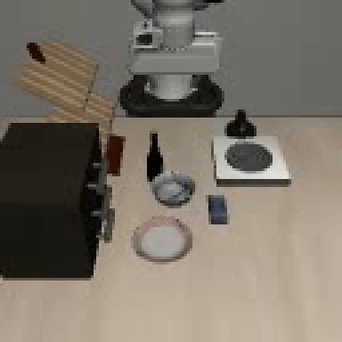
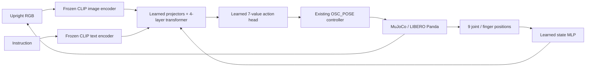
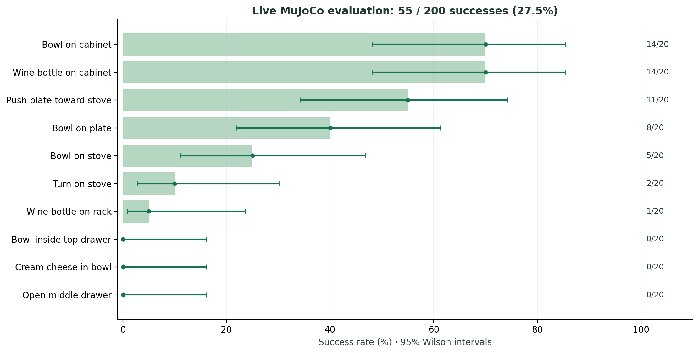

# CLIP-conditioned robot learning on LIBERO-Goal

[](https://github.com/samisaliveagain/libero-clip-vla)
[](https://huggingface.co/Samisaliveagain/libero-clip-vla)
[](https://huggingface.co/datasets/Samisaliveagain/libero-goal-vla)
[](LICENSE)

A local vision-language-action learning project: frozen CLIP image/text encoders feed a small learned fusion transformer that controls a Franka Panda in MuJoCo. The policy learns from LIBERO demonstrations through behavior cloning, using RGB, a language instruction, and joint/gripper state.

Built and evaluated on native Windows with an RTX 4050 Laptop GPU (6 GB). This is a supervised, simulation-only baseline; it is not a general-purpose robot foundation model or a reproduction of LIBERO's lifelong-learning benchmark.



*A selected successful rollout, not an aggregate performance claim. [Watch the complete clip](docs/media/put_the_bowl_on_top_of_the_cabinet_success_reset020.mp4), or compare a [timeout on the same task](docs/media/put_the_bowl_on_top_of_the_cabinet_failure_reset022.mp4).*

**[Watch six demos](docs/VIDEOS.md) · [Explore the results](docs/RESULTS.md) · [Run the policy](docs/SETUP.md)**

## Code here. Heavy artifacts on Hugging Face.

| Repository | Contents |
| --- | --- |
| [GitHub: source and demos](https://github.com/samisaliveagain/libero-clip-vla) | Python code, setup, architecture, compact results, six videos, preview GIF |
| [Hugging Face: trained policy and experiment artifacts](https://huggingface.co/Samisaliveagain/libero-clip-vla) | All 21 saved training checkpoints, raw evaluation videos/traces, logs, configs, SHA-256 inventory |
| [Hugging Face: LIBERO-Goal data](https://huggingface.co/datasets/Samisaliveagain/libero-goal-vla) | Ten original HDF5 task files, audited episode splits and normalization metadata |

The frozen CLIP backbone is downloaded from its existing [upstream Hugging Face repository](https://huggingface.co/openai/clip-vit-base-patch16) at the pinned revision, avoiding another copy in this project. LIBERO's simulation assets stay in its pinned upstream submodule.

## What the policy learns



- **PRETRAINED + FROZEN:** CLIP ViT-B/16 image and text encoders.
- **TRAINED BY US:** visual/text projectors, proprioception MLP, modality embeddings, action query, four-layer fusion transformer, and continuous action head.
- **NON-LEARNED INFRASTRUCTURE:** preprocessing, dataset reader, loss/optimizer machinery, controller, physics, renderer, and success predicates.
- **PRETRAINED + FINE-TUNED:** none in this baseline.

The action is `[dx, dy, dz, dRx, dRy, dRz, gripper]` in the existing normalized controller domain. CLIP does not predict robot commands by itself. [Architecture and data contracts](docs/ARCHITECTURE.md).

## Measured results

The frozen epoch-6 policy completed **55 of 200 fixed-reset rollouts (27.5%)**, across ten goals. These are descriptive results for one training seed and a custom startup protocol, not an official benchmark score. Eight tasks were added after the first two tasks' outcomes were visible.



| Task | Successes / rollouts |
| --- | ---: |
| Bowl on plate | 8 / 20 |
| Bowl on stove | 5 / 20 |
| Bowl on cabinet | 14 / 20 |
| Open middle drawer | 0 / 20 |
| Open top drawer and put bowl inside | 0 / 20 |
| Push plate toward stove | 11 / 20 |
| Cream cheese in bowl | 0 / 20 |
| Wine bottle on rack | 1 / 20 |
| Wine bottle on cabinet | 14 / 20 |
| Turn on stove | 2 / 20 |

Protocol: reset indices 20–39 per task; ten open-gripper settling actions; up to 600 learned actions at 20 Hz simulated control. All 145 unsuccessful rollouts reached the horizon; no execution faults were recorded. The reset states were withheld from development selection, but are not claimed disjoint from the demonstration initial states. Separate offline action-error evaluation uses withheld whole demonstration episodes.

The evaluation remains **partial**: final image/proprioception ablations, novel visual/placement shifts, contact analysis, and multiple training seeds were not completed. [Results, provenance, and limitations](docs/RESULTS.md) · [Success and failure videos](docs/VIDEOS.md).

## Run locally

See [setup and reproduction](docs/SETUP.md) for Python 3.11, pinned dependencies, the LIBERO submodule, Windows compatibility fixes, and data/model downloads. No credentials are needed for the public downloads.

```cmd
git submodule update --init
python scripts\configure_libero.py --check
python scripts\download_clip_stage3.py
python scripts\download_project_artifacts.py --dataset --checkpoint
```

Training datasets and model weights stay outside normal Git commits. The artifact downloader restores the dataset and exact selected checkpoint from Hugging Face and verifies SHA-256 before use. Use `--all-artifacts` to restore the complete experiment archive. [Storage and restoration details](docs/ARTIFACTS.md).

## Repository map

| Path | Role |
| --- | --- |
| `scripts/libero_dataset_adapter.py` | Whole-episode splits, audited one-step alignment, state normalization |
| `scripts/clip_features.py` / `frozen_clip_encoder.py` | Frozen CLIP features and encoder inspections, sharing one download |
| `scripts/libero_policy.py` | Trainable multimodal policy and behavior-cloning objective |
| `scripts/train_libero_policy.py` | Lightning training and checkpoint handling |
| `scripts/rollout_libero_policy.py` | Closed-loop simulation, official success predicates, traces and videos |
| `data/manifests/` | Dataset hashes, episode membership, alignment, training-only normalizers |
| `docs/results/` | Saved per-reset reports and offline evaluation evidence |
| `docs/media/` | Curated videos, posters, and preview GIF |
| `third_party/LIBERO` | Upstream dependency pinned as a Git submodule |

Personal ChatGPT instructions, planning notes, interview exports, caches, datasets, and raw training outputs are ignored. [GitHub publishing steps](docs/PUBLISHING.md) · [Upstream attribution](THIRD_PARTY_NOTICES.md).

Original code and trained policy checkpoints are MIT licensed. The mirrored LIBERO dataset retains its upstream Apache-2.0 license; third-party assets and pretrained CLIP retain their own terms.
