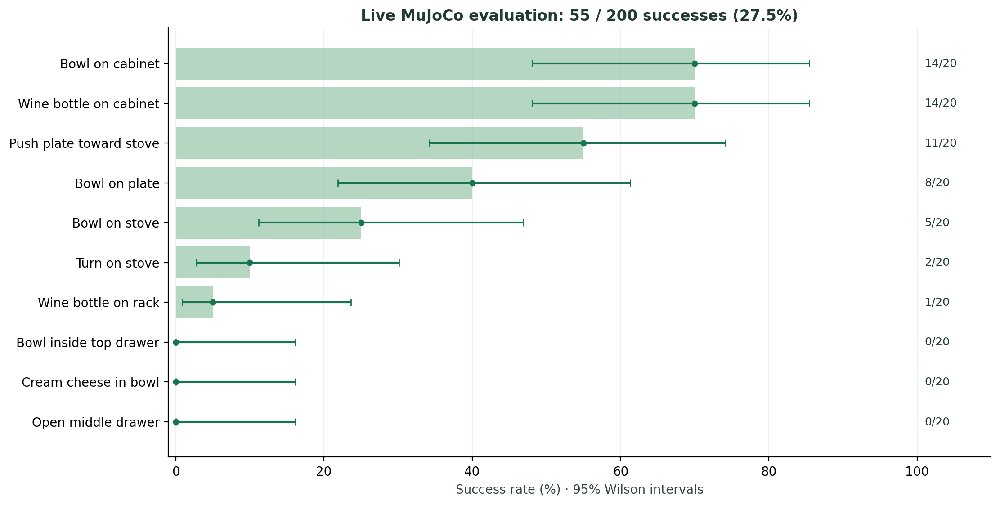
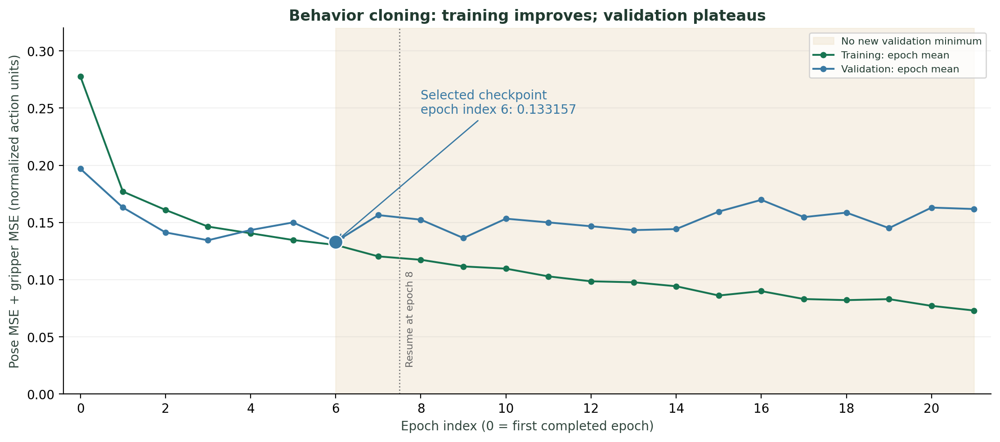

# Recorded evaluation results

The frozen checkpoint SHA-256 is `3731f123462be5bee742cfcb45a595386b68a5963150e1a7079328315eca36cf`. This is one local supervised LIBERO-Goal experiment with one training seed. Evaluation gates remain open.

## Closed-loop results

The plotted intervals are 95% Wilson binomial intervals for 20 rollouts per task. Fixed simulator states and one training seed do not establish robustness over arbitrary placements or independent training runs.

| Task | Successes / rollouts | Recorded evidence |
| --- | ---: | --- |
| put the bowl on the plate | 8 / 20 | [Per-reset report](results/put_the_bowl_on_the_plate_report.json) |
| put the bowl on top of the cabinet | 14 / 20 | [Per-reset report](results/put_the_bowl_on_top_of_the_cabinet_report.json) |
| open the middle drawer of the cabinet | 0 / 20 | [Per-reset report](results/open_the_middle_drawer_of_the_cabinet_report.json) |
| open the top drawer and put the bowl inside | 0 / 20 | [Per-reset report](results/open_the_top_drawer_and_put_the_bowl_inside_report.json) |
| push the plate to the front of the stove | 11 / 20 | [Per-reset report](results/push_the_plate_to_the_front_of_the_stove_report.json) |
| put the bowl on the stove | 5 / 20 | [Per-reset report](results/put_the_bowl_on_the_stove_report.json) |
| put the cream cheese in the bowl | 0 / 20 | [Per-reset report](results/put_the_cream_cheese_in_the_bowl_report.json) |
| put the wine bottle on the rack | 1 / 20 | [Per-reset report](results/put_the_wine_bottle_on_the_rack_report.json) |
| put the wine bottle on top of the cabinet | 14 / 20 | [Per-reset report](results/put_the_wine_bottle_on_top_of_the_cabinet_report.json) |
| turn on the stove | 2 / 20 | [Per-reset report](results/turn_on_the_stove_report.json) |

Total: **55 / 200 (27.5%)**. All 145 unsuccessful outcomes are horizon timeouts; there were no execution faults. The first two tasks were selected before evaluation; coverage of the other eight was chosen after those initial results were visible. Pooling is descriptive and does not replace the per-task outcomes.

## Protocol and limits

- Fixed reset indices 20?39 per task; ten open-gripper settling steps; 600-action horizon; simulated control at 20 Hz.
- Checkpoint selected using validation/development evidence, then frozen.
- Final reset IDs are separate from development IDs, but their simulator starting states are not asserted disjoint from the original demonstrations.
- Supervised train/validation/test partitions are disjoint whole episodes (40/5/5 per task); offline test evaluation has 6,195 aligned action pairs.
- Final image/proprioception ablations, novel visual/placement shifts, unwanted-contact taxonomy, and multi-training-seed comparisons remain incomplete.
- The custom ten-open startup protocol is separate from the earlier five-zero protocol and must not be pooled with it.
- No real-robot deployment, unseen-task generalization, or official lifelong-learning benchmark reproduction is claimed.

## Evidence files

Epoch index 6 was selected using validation/development evidence. Training loss continued to improve while validation plateaued. The curve is derived from the saved merged training metrics linked below; action error alone does not establish closed-loop competence.

- [Summary and source provenance](results/summary.json)
- [Offline test action errors and checkpoint reload check](results/offline_test.json)
- [Training configuration](results/training_run_config.json) and [training result](results/training_result.json)
- [Merged training metrics](results/training_metrics_merged.csv)
- [Original evaluation plan](results/frozen_eval_plan.json); written after the first final cabinet rollout, as the plan itself records.
- [Representative success and failure videos](VIDEOS.md)

Offline action error is not a closed-loop success rate. Raw reports retain original artifact references; published video paths and hashes are mapped in [videos.json](videos.json). The exact frozen checkpoint and complete raw outputs are hosted in the [Hugging Face experiment archive](https://huggingface.co/Samisaliveagain/libero-clip-vla). [Restore them](ARTIFACTS.md) to the original project paths when reproducing the experiment.
