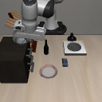
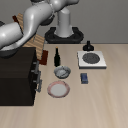
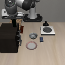
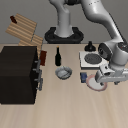
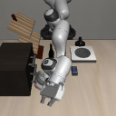
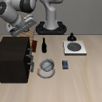

# Demo videos

Four selected successful rollouts and two timeout examples. They illustrate behavior; the full ten-task results are in [RESULTS.md](RESULTS.md).

Each MP4 is a complete saved rollout encoded as H.264/yuv420p, with no trimming or speed change. These clips are small enough to commit directly. Click a thumbnail to open its MP4.

| Task / outcome | Reset | Video |
| --- | ---: | --- |
| Bowl on cabinet ? success | 20 |  |
| Bowl on cabinet ? failure | 22 |  |
| Wine bottle on cabinet ? success | 20 |  |
| Push plate toward stove ? success | 20 |  |
| Bowl on plate ? success | 22 |  |
| Bowl on plate ? failure | 20 |  |

[Machine-readable selection, source paths, and video SHA-256 hashes](videos.json). The source reports identify the official success outcome and stopping reason for each reset.
